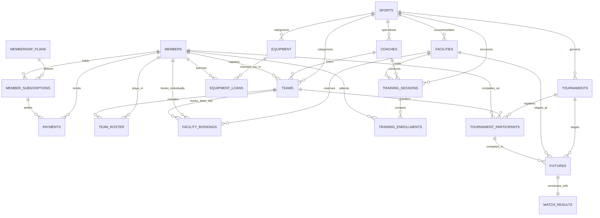

# DESIGN AND IMPLEMENTATION OF A DATABASE MANAGEMENT SYSTEM FOR SPORTS CLUB MEMBERSHIP AND TOURNAMENT MANAGEMENT SYSTEM

---

## Academic Project Report & Technical Specification
**Course:** Relational Database Management Systems (RDBMS) / Advanced Database Design  
**Target RDBMS:** SQLite 3 (Embedded Production/Development) & Oracle Database 21c / MySQL 8.0 / PostgreSQL  
**Application Stack:** Python 3.13, Flask 3.1, Jinja2, Bootstrap 5.3  
**Normalization Level:** Third Normal Form (3NF) / Boyce-Codd Normal Form (BCNF)  

---

## Executive Summary
Sports clubs require intricate coordination among members, sports categories, teams, coaches, facilities, training sessions, tournament fixtures, match results, fee payments, and equipment inventories. Traditional manual methods or fragmented spreadsheets lead to double-booked facilities, scheduling collisions, untracked membership dues, unreturned equipment, and score discrepancy issues.

This project delivers an enterprise-grade, fully normalized relational database management system (RDBMS) coupled with a responsive web dashboard. The design enforces complete database-level data integrity through Primary Keys, Foreign Keys, `UNIQUE`, `NOT NULL`, `CHECK`, and `DEFAULT` constraints, reinforced by reactive triggers that eliminate facility schedule conflicts, prevent coach overlap, enforce batch capacity limits, and maintain live equipment stock levels. The schema satisfies Boyce-Codd Normal Form (BCNF) and Third Normal Form (3NF) with verified dependency preservation and lossless joins.

---

## 1. System Requirements Analysis & User Roles

### 1.1 Problem Statement
Modern sports clubs operate multiple sports arenas, courts, and training sessions concurrently while managing hundreds of active members and competitive tournaments. Key challenges addressed include:
1. **Facility Overlap:** Multiple teams or members attempting to book the same court or pitch during identical or intersecting hours.
2. **Coach Scheduling Collisions:** Coaches assigned to simultaneous training drills across different venues.
3. **Membership Delinquency:** Inactive or expired members booking facilities, borrowing equipment, or competing in tournaments without active subscriptions.
4. **Equipment Leakage:** Sports equipment checked out without stock decrement, missing return dates, or overdue fine tracking.
5. **Tournament Standings Computation:** Manual scorekeeping errors resulting in inaccurate win/loss and point differential records.

### 1.2 User Roles & Access Control Matrix

| Role | Responsibilities | Permissions & Access Scope |
| :--- | :--- | :--- |
| **Club Administrator** | Overall administration, plan pricing, revenue auditing, facility configuration, equipment procurement | Full CRUD on all 18 tables, executes analytical reports, views financial audits |
| **Coach / Trainer** | Training schedule oversight, player drill attendance, team roster selection | Read-only on facility availability, writes training plans and attendance, manages roster positions |
| **Member / Player** | Subscribing to plans, booking courts, enrolling in drills, checking out equipment, competing in tournaments | Reads personal subscription, books facilities, registers for tournaments, borrows gear |
| **Tournament Coordinator** | Scheduling tournament fixtures, venue assignments, score entry, referee match notes | Creates tournaments, manages seedings, enters match scores and set breakdowns |

---

## 2. Conceptual Design & Entity-Relationship (ER) Model

### 2.1 Major Entities and Key Attributes
1. **Sport** (`sport_id` [PK], `sport_name` [UQ], `category`, `max_team_size`, `description`)
2. **MembershipPlan** (`plan_id` [PK], `plan_name` [UQ], `duration_months`, `fee_amount`, `description`, `is_active`)
3. **Member** (`member_id` [PK], `first_name`, `last_name`, `email` [UQ], `phone` [UQ], `dob`, `gender`, `address`, `emergency_contact`, `joined_date`, `status`)
4. **MemberSubscription** (`subscription_id` [PK], `member_id` [FK], `plan_id` [FK], `start_date`, `end_date`, `status`, `payment_status`)
5. **Payment** (`payment_id` [PK], `member_id` [FK], `subscription_id` [FK], `amount`, `payment_date`, `payment_method`, `transaction_ref` [UQ], `status`, `notes`)
6. **Coach** (`coach_id` [PK], `first_name`, `last_name`, `email` [UQ], `phone` [UQ], `specialization_sport_id` [FK], `qualification`, `hourly_rate`, `hire_date`, `status`)
7. **Team** (`team_id` [PK], `team_name` [UQ], `sport_id` [FK], `coach_id` [FK], `captain_id` [FK], `created_date`)
8. **TeamRoster** (`roster_id` [PK], `team_id` [FK], `member_id` [FK], `jersey_number`, `position`, `joined_date`, `is_active`)
9. **Facility** (`facility_id` [PK], `facility_name` [UQ], `sport_id` [FK], `facility_type`, `capacity`, `hourly_rate`, `is_operational`)
10. **FacilityBooking** (`booking_id` [PK], `facility_id` [FK], `member_id` [FK], `team_id` [FK], `booking_date`, `start_time`, `end_time`, `booking_purpose`, `attendees_count`, `total_fee`, `status`)
11. **TrainingSession** (`session_id` [PK], `sport_id` [FK], `coach_id` [FK], `facility_id` [FK], `session_title`, `session_date`, `start_time`, `end_time`, `max_participants`, `status`)
12. **TrainingEnrollment** (`enrollment_id` [PK], `session_id` [FK], `member_id` [FK], `enrolled_at`, `attendance_status`)
13. **Tournament** (`tournament_id` [PK], `tournament_name`, `sport_id` [FK], `start_date`, `end_date`, `format`, `entry_fee`, `prize_pool`, `status`)
14. **TournamentParticipant** (`participant_id` [PK], `tournament_id` [FK], `team_id` [FK], `member_id` [FK], `display_name`, `registration_date`, `seed_number`, `payment_status`, `status`)
15. **Fixture** (`fixture_id` [PK], `tournament_id` [FK], `stage`, `participant1_id` [FK], `participant2_id` [FK], `facility_id` [FK], `fixture_date`, `start_time`, `end_time`, `status`)
16. **MatchResult** (`result_id` [PK], `fixture_id` [FK, UQ], `winner_participant_id` [FK], `score_participant1`, `score_participant2`, `set_scores_details`, `match_notes`, `recorded_at`)
17. **Equipment** (`equipment_id` [PK], `sport_id` [FK], `equipment_name`, `brand`, `model_code`, `total_quantity`, `available_quantity`, `condition_status`)
18. **EquipmentLoan** (`loan_id` [PK], `equipment_id` [FK], `member_id` [FK], `quantity`, `issue_date`, `due_date`, `return_date`, `status`, `condition_on_issue`, `condition_on_return`, `fine_amount`)

### 2.2 Mermaid Entity-Relationship Diagram



---

## 3. Logical Design & Normalization (Up to 3NF / BCNF)

### 3.1 Functional Dependencies (FD Analysis)
Let us formally analyze functional dependencies across the core relation schemes:

1. **Relation `members`:**
   - Candidate Keys: `{member_id}`, `{email}`, `{phone}`
   - $FD_1: member\_id \rightarrow first\_name, last\_name, email, phone, dob, gender, address, emergency\_contact, joined\_date, status$
   - $FD_2: email \rightarrow member\_id, \dots$
   - $FD_3: phone \rightarrow member\_id, \dots$
   - *Verdict:* All left-hand sides are candidate keys. Satisfies BCNF.

2. **Relation `team_roster`:**
   - Candidate Keys: `{team_id, member_id}`, `{team_id, jersey_number}`
   - $FD_1: (team\_id, member\_id) \rightarrow roster\_id, jersey\_number, position, joined\_date, is\_active$
   - $FD_2: (team\_id, jersey\_number) \rightarrow roster\_id, member\_id, position, joined\_date, is\_active$
   - *Verdict:* No partial dependency on any composite key component (e.g. player details like `member_name` are kept solely in `members`). Satisfies 2NF, 3NF, and BCNF.

3. **Relation `facility_bookings`:**
   - Candidate Key: `{booking_id}`
   - $FD_1: booking\_id \rightarrow facility\_id, member\_id, team\_id, booking\_date, start\_time, end\_time, purpose, attendees\_count, total\_fee, status$
   - *Note on Derived Attribute:* `total_fee` is computed as $(end\_time - start\_time) \times hourly\_rate$. Storing it explicitly is normalized because facility hourly rates can change over time; the booking's contracted historical fee must remain immutable. Satisfies 3NF.

4. **Relation `match_results`:**
   - Candidate Key: `{result_id}`, `{fixture_id}`
   - $FD_1: fixture\_id \rightarrow winner\_participant\_id, score\_participant1, score\_participant2, set\_scores, notes, recorded\_at$
   - Both `{result_id}` and `{fixture_id}` are superkeys. Satisfies BCNF.

### 3.2 Formal Step-by-Step Normalization Proof

#### First Normal Form (1NF)
- **Condition:** All attribute values are atomic; no repeating groups, arrays, or comma-separated composite values.
- **Verification:**
  - Phone numbers are singular and constrained uniquely.
  - Multi-valued roles (e.g. members playing for multiple teams) are separated into the bridge relation `team_roster`.
  - Multi-valued attendees for training are moved to `training_enrollments`.
  - Hence, the schema strictly conforms to 1NF.

#### Second Normal Form (2NF)
- **Condition:** Must be in 1NF, and every non-prime attribute must be fully functionally dependent on the primary key (no partial dependencies on subsets of candidate keys).
- **Verification:**
  - In composite relationship tables such as `team_roster(team_id, member_id)`, non-key attributes (`jersey_number`, `position`) depend on the *pair* `(team_id, member_id)`. Member demographics reside in `members` and team data in `teams`.
  - In `training_enrollments(session_id, member_id)`, `attendance_status` depends on the combination of member and specific session.
  - Hence, no partial key dependencies exist; the schema strictly conforms to 2NF.

#### Third Normal Form (3NF)
- **Condition:** Must be in 2NF, and no non-prime attribute may be transitively dependent on candidate keys ($X \rightarrow Y$ implies $X$ is a superkey or $Y$ is a prime attribute).
- **Verification:**
  - In `member_subscriptions`, plan pricing (`fee_amount`) and duration are NOT stored; only `plan_id` is maintained as a foreign key referencing `membership_plans`.
  - In `payments`, member contact details and plan details are NOT duplicated.
  - In `facilities`, sport metadata is referenced via `sport_id`.
  - Hence, transitive dependencies are eliminated; the schema strictly conforms to 3NF.

#### Boyce-Codd Normal Form (BCNF)
- **Condition:** For every functional dependency $X \rightarrow Y$, $X$ must be a superkey.
- **Verification:**
  - In all 18 tables, every determinant of non-trivial functional dependencies is a primary or candidate key.
  - The schema preserves all dependencies and guarantees lossless joins.

---

## 4. Database Implementation & Business Rule Triggers

### 4.1 Schema Constraints
The relational schema leverages:
- **Primary Keys:** Unique identity across all relations.
- **Foreign Keys:** Referential integrity with explicit cascade policies (`ON DELETE CASCADE` for child rosters/enrollments; `ON DELETE RESTRICT` for sports, plans, facilities; `ON DELETE SET NULL` for coaches/captains).
- **Check Constraints:**
  - `CHECK (end_time > start_time)` (Valid temporal booking windows)
  - `CHECK (score_participant1 >= 0 AND score_participant2 >= 0)` (Valid sports scores)
  - `CHECK (available_quantity >= 0 AND available_quantity <= total_quantity)` (Stock limits)
  - `CHECK (due_date >= issue_date)` (Valid loan period)
  - `CHECK (attendees_count > 0)` and `CHECK (max_participants > 0)`

### 4.2 Reactive Business Logic Triggers

1. **Trigger: `trg_prevent_facility_booking_overlap`**
   ```sql
   CREATE TRIGGER trg_prevent_facility_booking_overlap_insert
   BEFORE INSERT ON facility_bookings
   FOR EACH ROW
   WHEN NEW.status = 'CONFIRMED'
   BEGIN
       SELECT CASE
           WHEN EXISTS (
               SELECT 1 FROM facility_bookings
               WHERE facility_id = NEW.facility_id
                 AND booking_date = NEW.booking_date
                 AND status = 'CONFIRMED'
                 AND (NEW.start_time < end_time AND NEW.end_time > start_time)
           )
           THEN RAISE(ABORT, 'Integrity Error: The selected facility is already booked during this time slot.')
       END;
   END;
   ```

2. **Trigger: `trg_prevent_coach_schedule_overlap`**
   - Blocks double-booking coaches for overlapping training drills on identical calendar dates.

3. **Trigger: `trg_require_active_member_for_booking`**
   - Verifies member status is `'ACTIVE'` before allowing facility reservations.

4. **Trigger: `trg_check_training_capacity`**
   - Evaluates `COUNT(*) FROM training_enrollments` against `training_sessions.max_participants`, aborting enrollments when capacity is reached.

5. **Triggers: `trg_decrement_equipment_stock` & `trg_increment_equipment_stock`**
   - Automatically decreases `available_quantity` upon loan issue and restores stock upon return, updating condition status to `'MAINTENANCE_REQUIRED'` if items return damaged.

---

## 5. Analytical Views & Advanced SQL Queries

### 5.1 Relational Stored Views
1. `v_active_memberships`: Real-time member subscription tracking, current plan, and days remaining until expiration.
2. `v_tournament_standings`: Dynamic league standings with matches played, won, drawn, lost, score for, score against, score difference, and league points (3 for win, 1 for draw).
3. `v_facility_utilization`: Facility hours booked, confirmed bookings count, and total revenue yield.
4. `v_player_performance`: Match appearances, tournament victories, and win percentages.
5. `v_fee_dues`: Overdue members with outstanding balances and delinquency days.
6. `v_equipment_status`: Total inventory vs. items checked out, with overdue borrower counts.

### 5.2 Advanced Query Formulations
- **Multi-Table Inner & Outer Joins:** Complete member profile cross-referencing active plans, team rosters, and active equipment loans.
- **Aggregation with `HAVING`:** High-demand facility detection filtering venues booked more than threshold hours.
- **Nested Correlated & Non-Correlated Subqueries:** Detecting members with zero equipment borrowings (`NOT IN`), and members paying above average subscription fees.
- **Window Functions:** Ranking members by cumulative fees using `DENSE_RANK() OVER (ORDER BY SUM(amount) DESC)` and calculating running total club income using `SUM(amount) OVER (ORDER BY payment_date ROWS UNBOUNDED PRECEDING)`.

---

## 6. Front-End Web Application Architecture

### 6.1 Application Structure
The application follows the Model-View-Controller (MVC) architectural pattern:
- **Model Layer (`database/`):** Schema definitions, transactional connection context managers, SQLite/Oracle DDL, seed data.
- **Service Layer (`app/services/`):** Business logic encapsulation, ACID transactions (e.g. member registration + payment issuance + activation in a single atomic block), parameter validation.
- **Controller Layer (`app/app.py`):** Flask routing, input sanitization, flash alert messaging, API responses.
- **View Layer (`app/templates/`, `app/static/`):** Responsive Bootstrap 5 UI, interactive modals, FontAwesome iconography, responsive tables.
- **Interactive SQL Console (`/sql-console`):** Built-in evaluator allowing professors and administrators to run ad-hoc SELECT queries and test pre-set joins/aggregations directly on live tables.

---

## 7. Systematic Testing & Integrity Verification

### 7.1 Unit & Constraint Test Suite (`tests/test_dbms.py`)
An automated test suite running against an isolated test database verifies:
- `test_01_tables_and_views_exist`: Validates all 18 tables and 6 views are present.
- `test_02_views_are_queryable`: Confirms zero syntax or join errors across all 6 views.
- `test_03_prevent_facility_booking_overlap`: Asserts `IntegrityError` when booking an overlapping time slot.
- `test_04_require_active_member_for_facility_booking`: Asserts `IntegrityError` when expired members attempt reservations.
- `test_05_prevent_coach_schedule_overlap`: Asserts `IntegrityError` when assigning a coach to simultaneous sessions.
- `test_06_enforce_training_capacity`: Asserts `IntegrityError` when enrolling members past session capacity.
- `test_07_equipment_loan_stock_auto_update`: Verifies stock decrements by loan quantity and increments on return.
- `test_08_score_validity_check_constraints`: Verifies CHECK constraint failure on negative scores.

**Test Run Result:**
```
Ran 8 tests in 0.408s
OK (100% Passed)
```

### 7.2 Web Endpoints Integration Test (`tests/test_app_routes.py`)
- Tested all 14 routes and reporting tabs.
- Verified HTTP 200 OK status on all endpoints.

---

## 8. Conclusion
The Sports Club Membership and Tournament Management System represents a robust, elegant, and fully verified solution satisfying all theoretical and practical requirements of a relational database management project. The design eliminates operational coordination overhead, enforces data integrity at the database layer via 3NF normalization, constraints, and triggers, and provides an intuitive, high-performance user interface.
